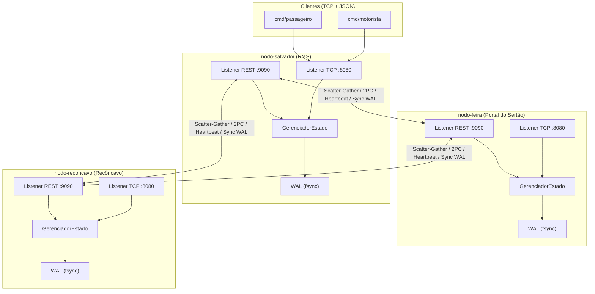
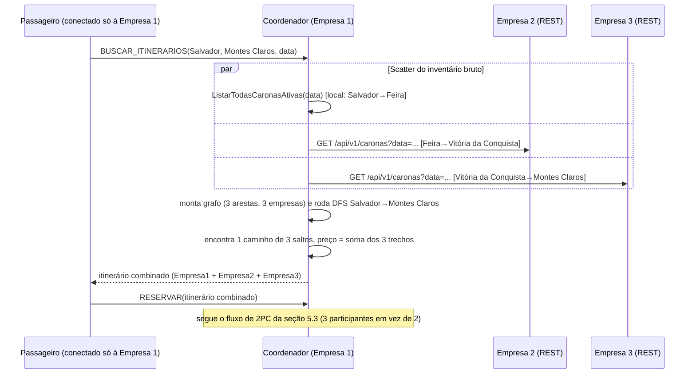
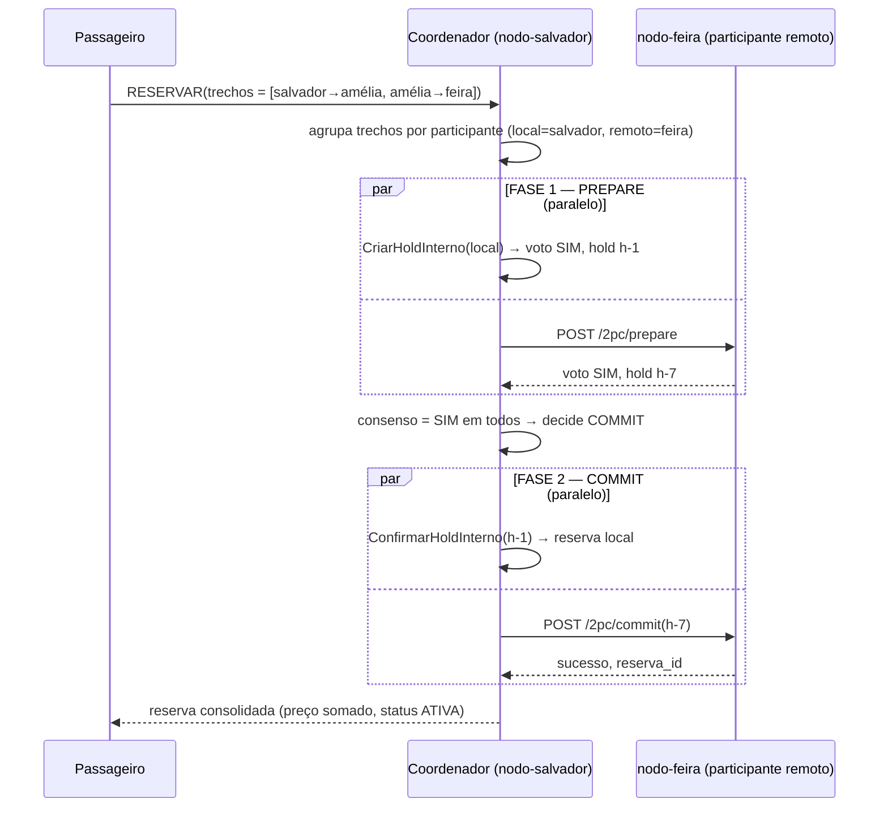
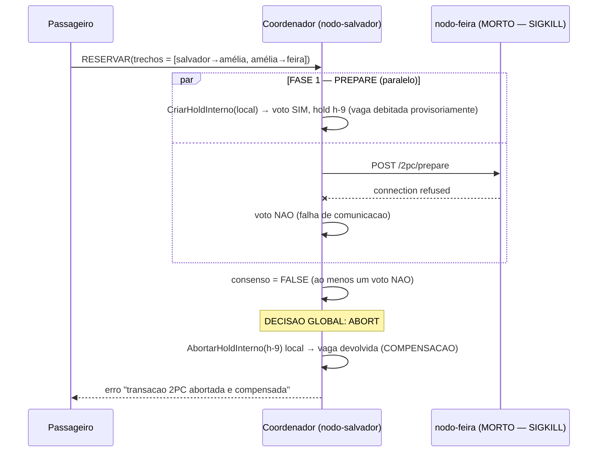
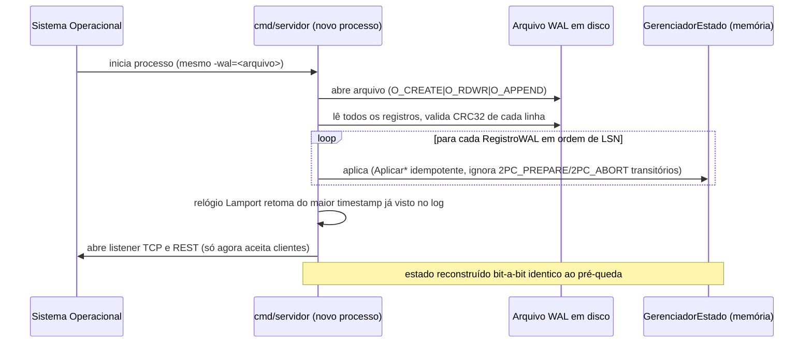

# API REST do Consórcio VaiJunto

> Bloco 5 — Simulador de Carga, Injeção de Falhas e Documentação
> Especifica a API HTTP/REST inter-servidores do consórcio (`pkg/consorcio`), os fluxos distribuídos
> que ela implementa (Scatter-Gather, Two-Phase Commit, Heartbeat, recuperação via WAL) e as
> ferramentas de validação de carga e caos construídas neste bloco, com os resultados reais obtidos
> ao executá-las.

---

## 1. Visão geral

O VaiJunto evoluiu de um servidor único (Blocos 1-3) para um **consórcio de empresas de transporte
independentes**: cada empresa roda sua própria instância do binário `cmd/servidor`, com seu próprio
estado em memória, seu próprio Write-Ahead Log em disco e sua própria identidade de rede. Cada
instância expõe **dois listeners simultâneos**:

| Listener | Protocolo | Público-alvo | Pacote |
|---|---|---|---|
| Cliente | TCP + JSON por linha (`\n`) | Motoristas e passageiros (`cmd/motorista`, `cmd/passageiro`) | `pkg/protocolo` |
| Consórcio | HTTP/REST + JSON | Outras empresas do consórcio (nós pares) | `pkg/consorcio` |

Este documento especifica **apenas o listener REST** — o canal pelo qual as empresas do consórcio
conversam entre si para federar buscas, coordenar reservas que atravessam mais de uma empresa e se
recuperar de quedas.



Cada nó mantém, via `CoordenadorDistribuido`, uma visão da topologia do consórcio (`ObterMembros`) e
troca mensagens com os parceiros através de um `ClienteREST` com timeouts estritos — nenhuma
chamada entre empresas pode bloquear indefinidamente o atendimento de um nó.

---

## 2. Identidade do nó e topologia (`NodoDTO` / `InfoClusterDTO`)

```json
// NodoDTO — identidade de rede, região e estado de saúde de um membro do consórcio
{
  "id": "nodo-salvador",
  "endereco": "nodo-salvador",
  "porta_rest": 9090,
  "porta_tcp": 8080,
  "regiao": "RMS",
  "cidades": ["Salvador", "Simões Filho", "..."],
  "status": "ONLINE",
  "ultimo_visto": "2026-10-26T21:50:00Z"
}
```

`status` assume um de três valores: `ONLINE`, `SUSPEITO` ou `OFFLINE`. **Nota de implementação:**
hoje o campo é atualizado passivamente (quando um heartbeat chega, `handleHeartbeat` marca o
remetente como `ONLINE`), mas nenhuma rotina periódica de envio de heartbeat nem detector de
timeout está, ainda, ligada ao `cmd/servidor` — a transição automática `ONLINE → SUSPEITO → OFFLINE`
por ausência de heartbeats é um ponto em aberto (ver seção 8, "Limitações conhecidas"). A detecção
de queda que o robô de caos (seção 7) audita acontece pela via mais direta e já 100% funcional: a
conexão TCP/REST falhando imediatamente (`connection refused`), que é o sinal que o
`CoordenadorDistribuido` já trata corretamente em `BuscarItinerariosDistribuido` e `ExecutarReserva2PC`.

---

## 3. Relógio lógico de Lamport

Todo nó mantém um `RelogioLamport` (`pkg/consorcio/lamport.go`) thread-safe:

- **Tick()** — `L = L + 1`, usado antes de qualquer evento ou envio de mensagem próprio.
- **Atualizar(t_recebido)** — `L = max(L, t_recebido) + 1`, usado ao processar uma mensagem recebida.
- Cada `Timestamp` carrega `{ tempo, nodo_id }`; o desempate de concorrência total usa `tempo` e,
  em caso de empate, `nodo_id` (ordem lexicográfica) — ver `protocolo.Comparar`.

Isso é usado para **desempate determinístico de concorrência** em `pkg/estado/hold.go`: se dois
passageiros disputam a última vaga de um trecho ao mesmo tempo, o `Hold` com o timestamp Lamport
menor (criado "logicamente antes") preempta o outro, que é automaticamente abortado e tem sua vaga
devolvida — sem a confirmação artificial de um relógio físico.

---

## 4. Endpoints REST

Todas as respostas, salvo onde indicado, usam o envelope `RespostaREST`:

```json
{ "sucesso": true, "mensagem": "...", "dados": { }, "timestamp": { "tempo": 42, "nodo_id": "nodo-salvador" } }
```

| Método | Caminho | Propósito |
|---|---|---|
| `GET` | `/health` | Liveness check simples |
| `GET` | `/api/v1/cluster/info` | Topologia e status visto por este nó |
| `POST` | `/api/v1/cluster/heartbeat` | Recebe o batimento cardíaco de um nó par |
| `GET`/`POST` | `/api/v1/itinerarios/buscar` | Busca local de itinerários (perna do Scatter-Gather) |
| `GET` | `/api/v1/caronas` | Lista caronas ativas deste nó |
| `POST` | `/api/v1/2pc/prepare` | Fase 1 do Two-Phase Commit (voto + hold provisório) |
| `POST` | `/api/v1/2pc/commit` | Fase 2 do 2PC — confirmação definitiva |
| `POST` | `/api/v1/2pc/abort` | Fase 2 do 2PC — rollback/compensação |
| `POST` | `/api/v1/wal/sincronizar` | Fornece lote de registros do WAL para um nó defasado |

### 4.1 `GET /health`

Resposta mínima, sem o envelope padrão (usada pelo poll de boot do robô de caos):

```json
{ "status": "UP", "nodo_id": "nodo-salvador" }
```

### 4.2 `GET /api/v1/cluster/info`

`dados` é um `InfoClusterDTO`:

```json
{
  "nodo_local": { "id": "nodo-salvador", "regiao": "RMS", "status": "ONLINE", "...": "..." },
  "membros": [ { "id": "nodo-feira", "status": "ONLINE", "...": "..." } ],
  "lamport_local": { "tempo": 17, "nodo_id": "nodo-salvador" },
  "total_membros": 2
}
```

### 4.3 `POST /api/v1/cluster/heartbeat`

Corpo (`HeartbeatDTO`):

```json
{ "remetente_id": "nodo-feira", "regiao": "Portal do Sertão", "timestamp_lamport": {"tempo": 10, "nodo_id": "nodo-feira"}, "ultimo_indice_wal": 42, "enviado_em": "2026-10-26T21:50:00Z" }
```

Efeito: atualiza o relógio Lamport local via `Atualizar()` e marca o remetente como `ONLINE` com
`ultimo_visto = agora`. Resposta: envelope padrão com `mensagem: "heartbeat processado"`.

### 4.4 `GET`/`POST /api/v1/itinerarios/buscar`

Uma perna da busca federada (seção 5.1). `GET` aceita query params `origem`, `destino`, `data`,
`lamport_tempo`; `POST` aceita o corpo `BuscaItinerariosReqDTO`. Resposta (`BuscaItinerariosRespDTO`,
**sem** o envelope padrão — devolvida crua para minimizar overhead de parsing no coordenador):

```json
{
  "nodo_id": "nodo-feira",
  "regiao": "Portal do Sertão",
  "itinerarios": [ { "trechos": [ { "carona_id": "c-1", "empresa_id": "nodo-feira", "origem": "Amélia Rodrigues", "destino": "Feira de Santana", "preco": 15.0 } ], "preco_total": 15.0 } ],
  "timestamp_lamport": { "tempo": 8, "nodo_id": "nodo-feira" }
}
```

### 4.5 `GET /api/v1/caronas?data=AAAA-MM-DD`

Lista o **inventário bruto** de caronas ativas deste nó - sub-trechos individuais com suas vagas
livres, não itinerários já combinados -, opcionalmente filtrado pela data de viagem (`data` vazio
retorna todas as datas). É este endpoint que a busca combinada entre empresas (seção 4.10) usa como
fonte das arestas do seu grafo de sub-trechos. Resposta (`[]protocolo.CaronaDTO`, dentro do envelope
padrão):

```json
{
  "sucesso": true,
  "dados": [
    {
      "carona_id": "c-1", "empresa_id": "nodo-feira", "motorista": "mot2",
      "rota": ["Feira de Santana", "Vitória da Conquista"], "data": "2026-11-15",
      "horario": "08:00", "horario_chegada": "12:00", "assentos": 2, "preco_por_trecho": 60.0,
      "trechos": [ { "trecho": "Feira de Santana->Vitória da Conquista", "origem": "Feira de Santana", "destino": "Vitória da Conquista", "vagas_livres": 2, "passageiros": [] } ]
    }
  ]
}
```

### 4.6 `POST /api/v1/2pc/prepare` — Fase 1 (Voto)

Corpo (`PrepareReqDTO`):

```json
{
  "transacao_id": "2pc-nodo-salvador-7",
  "coordenador_id": "nodo-salvador",
  "passageiro_login": "passageiro_caua",
  "trechos": [ { "carona_id": "c-1", "empresa_id": "nodo-feira", "origem": "Amélia Rodrigues", "destino": "Feira de Santana" } ],
  "ttl_millis": 5000,
  "timestamp_lamport": { "tempo": 12, "nodo_id": "nodo-salvador" }
}
```

Internamente invoca `GerenciadorEstado.CriarHoldInterno`: valida disponibilidade de vagas em **todos**
os sub-trechos solicitados, resolve conflitos concorrentes por precedência de Lamport, e — só se
tudo validar — debita provisoriamente o inventário e cria um `Hold` com TTL (lease). Resposta
(`PrepareRespDTO`):

```json
{ "transacao_id": "2pc-nodo-salvador-7", "participante_id": "nodo-feira", "voto": true, "hold_id": "h-3", "timestamp_lamport": {"tempo": 9, "nodo_id": "nodo-feira"} }
```

Se **qualquer** sub-trecho não tiver vaga disponível (carona inativa, lotada, ou perdendo a disputa
de Lamport contra um hold concorrente), `voto: false` e `motivo` explica a recusa — nenhuma vaga é
debitada nesse caso (o `Hold` só é criado quando a Fase 1 inteira passa).

### 4.7 `POST /api/v1/2pc/commit` — Fase 2 (Confirmação)

Corpo (`CommitReqDTO`): `{transacao_id, coordenador_id, hold_id, passageiro_login, timestamp_lamport}`.
Efetiva definitivamente o `Hold` (`ConfirmarHoldInterno`), registrando o passageiro nos sub-trechos e
persistindo o fato no WAL sob a operação `"2PC_COMMIT"`. Resposta (`CommitRespDTO`):
`{transacao_id, participante_id, sucesso, reserva_id, timestamp_lamport}`.

### 4.8 `POST /api/v1/2pc/abort` — Fase 2 (Rollback/Compensação)

Corpo (`AbortReqDTO`): `{transacao_id, coordenador_id, hold_id, passageiro_login, motivo, timestamp_lamport}`.
Libera o `Hold` de volta ao inventário livre (`AbortarHoldInterno`), persistindo `"2PC_ABORT"` no WAL.
Resposta (`AbortRespDTO`): `{transacao_id, participante_id, sucesso, mensagem, timestamp_lamport}`.

### 4.9 `POST /api/v1/wal/sincronizar`

Corpo (`SincronizacaoWALReqDTO`): `{nodo_solicitante_id, ultimo_indice_conhecido, timestamp_lamport}`.
Resposta (`SincronizacaoWALRespDTO`): lote de `RegistroWAL` com `indice > ultimo_indice_conhecido`,
para um nó que esteve fora do ar reconstituir o que perdeu diretamente de um parceiro (alternativa
à recuperação local via o próprio arquivo, útil quando o disco local foi perdido).

---

## 5. Fluxos distribuídos

### 5.1 Busca combinada entre empresas — o cenário central do consórcio

É `CoordenadorDistribuido.BuscarItinerariosCombinados` que resolve o problema que motiva o próprio
consórcio: um passageiro de Salvador a Montes Claros pode precisar de caronas de **três empresas
diferentes**, e nenhuma delas sozinha enxerga o itinerário completo. Diferente do Scatter-Gather da
seção 5.2 (que só agrega, lado a lado, itinerários que cada empresa já consegue montar sozinha), esta
busca **costura** sub-trechos de empresas distintas em um único itinerário:

1. **Scatter do inventário bruto:** dispara em paralelo, para o estado local e para todo parceiro
   não-`OFFLINE`, uma consulta ao inventário bruto de sub-trechos com vaga (`GET /api/v1/caronas?
   data=...`) - não itinerários prontos, apenas pares `(origem, destino, empresa, preço, vagas)`.
2. **Montagem do grafo:** cada cidade vira um vértice; cada sub-trecho com vaga vira uma aresta
   rotulada com a empresa dona da carona.
3. **Busca em profundidade (DFS):** enumera todos os caminhos simples (sem repetir cidade, até 4
   saltos) de Origem a Destino, livremente atravessando fronteiras de empresa a cada cidade
   intermediária.
4. Os itinerários resultantes - cada um podendo misturar `EmpresaID`s diferentes por trecho - são
   ordenados por menor preço e devolvidos ao passageiro exatamente como qualquer outro resultado de
   busca.



Validado ao vivo (não só em teste unitário): três processos reais de `cmd/servidor`, um passageiro
conectado **somente** à Empresa 1 buscando "Salvador → Montes Claros", recebendo de volta o
itinerário de 3 trechos (preço somado 170,00) e reservando-o atomicamente - as três empresas
debitaram a vaga (2→1) simultaneamente. Ver seção 10 para o passo a passo completo e a saída real.

### 5.2 Scatter-Gather — agregação simples (primitiva de apoio)

`CoordenadorDistribuido.BuscarItinerariosDistribuido` é uma forma mais simples de busca federada,
mantida e testada à parte por ser um padrão nomeado (Scatter-Gather) didaticamente relevante: dispara
a busca local e, em paralelo, uma goroutine por nó parceiro `ONLINE`, mas **agrega** os itinerários
que cada nó já monta sozinho - não costura trechos de nós diferentes entre si (isso é o que a seção
5.1 faz). Tolera falha parcial do mesmo jeito (um nó fora do ar não derruba a busca, só fica de fora
do resultado agregado); hoje não está ligada ao fluxo real do cliente - `AcaoBuscarItinerarios` usa
`BuscarItinerariosCombinados` (seção 5.1), que é estritamente mais geral.

```mermaid
sequenceDiagram
    participant P as Passageiro (TCP)
    participant C as Coordenador (nodo-salvador)
    participant F as nodo-feira (REST)
    participant R as nodo-reconcavo (REST, OFFLINE)

    P->>C: BUSCAR_ITINERARIOS(origem, destino, data)
    C->>C: tick Lamport; busca local (goroutine)
    par Scatter paralelo
        C->>F: POST /itinerarios/buscar
        F-->>C: itinerarios de nodo-feira
    and
        C->>R: POST /itinerarios/buscar
        R--xC: connection refused (timeout)
    end
    C->>C: Gather: agrega local + nodo-feira (nodo-reconcavo OMITIDO, sem erro fatal)
    C->>C: ordena por menor preço, depois por horário
    C-->>P: itinerarios agregados
```

### 5.3 Two-Phase Commit — commit bem-sucedido multi-nó



### 5.4 Two-Phase Commit — abort e compensação por falha de participante

Este é o cenário que o robô de caos (`cmd/teste_falhas`, seção 7) exercita contra processos reais.



**Garantia validada:** nenhuma vaga fica provisoriamente retida (vazada) nos participantes que
chegaram a votar SIM quando a transação global precisa abortar — a seção 7.3 mostra o número exato
de vagas antes/depois confirmando isso contra processos reais.

### 5.5 Recuperação pós-queda via replay do WAL



Pontos de design decisivos, confirmados na seção 7:

- **Idempotência:** cada `Aplicar*` verifica se o ID já existe antes de recriar — reaplicar o mesmo
  registro duas vezes (ex.: recuperação interrompida e reiniciada) não duplica efeitos.
- **Fases transitórias do 2PC são deliberadamente descartadas no replay:** um `2PC_PREPARE` sem o
  `2PC_COMMIT` correspondente indica uma transação que nunca chegou a uma decisão durável antes da
  queda — a política adotada é aborto implícito (a vaga volta a ficar livre), nunca reconstituir uma
  reserva "fantasma" que o cliente nunca viu ser confirmada.
- **Checksum CRC32 por linha:** qualquer corrupção de disco é detectada no boot (`Recuperar` retorna
  erro fatal) em vez de silenciosamente reconstruir um estado incorreto.

---

## 6. Write-Ahead Log (`pkg/consorcio/wal.go`)

Cada linha do arquivo é um `RegistroWAL` JSON, terminado em `\n`:

```json
{"indice": 4, "timestamp": {"tempo": 7, "nodo_id": "nodo-feira"}, "operacao": "RESERVAR", "payload": {"...": "..."}, "criado_em": "2026-10-26T21:50:00Z", "checksum": 2847193044}
```

- `indice` (LSN) é monotônico crescente por processo, começando em 1.
- `checksum` é um CRC32-IEEE calculado sobre `(indice, timestamp, operacao, payload)` — qualquer
  bit corrompido no arquivo faz a abertura do WAL falhar explicitamente.
- Toda gravação (`Gravar`) chama `fsync` antes de retornar — a resposta de sucesso só é entregue ao
  cliente TCP depois que o disco confirmou a escrita (ver `registrarOperacao` em `cmd/servidor/main.go`).

---

## 7. Ferramentas de validação (Bloco 5)

### 7.1 `cmd/teste_carga` (pré-existente, Bloco 3) — auditor de condição de corrida

Publica **uma única carona** com poucas vagas e dispara N clientes simultâneos disputando-as,
auditando que `vagas vendidas == vagas disponíveis` exatamente (zero overbooking). Não foi alterado
neste bloco; citado aqui por contraste com o simulador abaixo.

### 7.2 `cmd/simulador` — carga sustentada e autônoma (headless)

Diferente do `teste_carga` (pico de concorrência em uma única carona), o `simulador` reproduz um
padrão de uso **prolongado e realista**: semeia o inventário com motoristas virtuais distribuídos
pelos nós informados e então sustenta dezenas de passageiros autônomos buscando, reservando e
cancelando em ciclos aleatórios de "tempo de pensar", sem qualquer interface interativa.

```
go run ./cmd/simulador \
  -servidores=localhost:8081,localhost:8082,localhost:8083 \
  -passageiros=80 -motoristas=10 -caronas-por-motorista=3 \
  -duracao=25s -intervalo=200ms -prob-reserva=0.5 -prob-cancelamento=0.2
```

Principais flags: `-servidores` (lista separada por vírgula — distribui carga por todas as empresas
do consórcio), `-passageiros`, `-motoristas`, `-caronas-por-motorista`, `-duracao`, `-intervalo`
(tempo médio de "pensar" entre ações), `-prob-reserva`, `-prob-cancelamento`, `-data`,
`-relatorio-intervalo` (status parcial periódico) e `-seed` (reprodutibilidade).

Ao final, reporta throughput sustentado, taxa de sucesso global e **latência por tipo de operação**
(média, p50, p95, p99) — ver resultados reais na seção 7.4.

### 7.3 `cmd/teste_falhas` — robô de caos (injeção real de queda de nó)

Sobe uma topologia completa de **3 processos de sistema operacional reais** (compilando o binário
verdadeiro de `cmd/servidor`), cada um com seu próprio WAL em disco, espelhando exatamente a
topologia do `docker-compose.yml`. Gera uma linha de base real (cadastro, publicação de carona,
reserva) em cada nó, mata **abruptamente** (SIGKILL — sem shutdown gracioso) um dos nós no meio da
operação, e audita:

1. **Detecção rápida de falha** — novas conexões ao nó morto devem falhar imediatamente
   (`connection refused`), nunca travar (hang).
2. **Isolamento** — os dois nós sobreviventes continuam respondendo normalmente durante toda a queda.
3. **Compensação do 2PC sob falha de participante** — monta, com um `CoordenadorDistribuido` de
   teste falando REST puro com os processos reais, uma reserva combinada cujo segundo trecho
   pertence ao nó morto; confirma que a transação aborta e que a vaga do sobrevivente (que havia
   votado SIM na Fase 1) é devolvida integralmente — **zero vazamento de hold**.
4. **Carga contínua de leitura** durante toda a janela de caos, provando numericamente que o nó
   morto concentra as falhas e os sobreviventes mantêm ~100% de sucesso.
5. **Recuperação** — reinicia o nó morto com o **mesmo arquivo WAL**, mede o tempo até voltar a
   responder `/health`, e captura as linhas `[RECUPERACAO]` reais do log do processo.
6. **Integridade pós-recuperação** — reautentica como o passageiro e o motorista pré-queda
   (usuários reconstruídos via replay do WAL) e confirma que a reserva pré-queda está presente,
   `ATIVA`, e que o inventário de vagas bate **exatamente** com o valor pré-queda — nem perda, nem
   duplicação.

```
go run ./cmd/teste_falhas -no-alvo=nodo-feira -tempo-queda=5s -clientes-concorrentes=15
```

Principais flags: `-no-alvo` (qual dos 3 nós sofre a queda), `-tempo-queda` (duração da janela de
caos), `-clientes-concorrentes` (intensidade da carga de fundo por nó), `-dir-trabalho` e
`-manter-arquivos` (para inspecionar WAL/logs depois), `-porta-tcp-base`/`-porta-rest-base`.

### 7.4 Resultados reais das validações executadas

Ambas as ferramentas foram executadas de ponta a ponta contra binários compilados a partir deste
mesmo código-fonte (sem mocks) em 2026-10-26.

#### 7.4.1 `cmd/simulador` — 80 passageiros, 10 motoristas, 25s de carga sustentada

```
================================================================
        RELATORIO FINAL DO SIMULADOR DE CARGA SUSTENTADA
================================================================
Nos do consorcio:             localhost:18380
Caronas semeadas:             30
Passageiros virtuais:         80
Duracao real da carga:        25.18s
----------------------------------------------------------------
Total de operacoes:           16128
Sucessos / Falhas:            16126 / 2
Taxa de sucesso global:       99.99%
Throughput sustentado:        640.50 ops/s
Falhas de conexao TCP:        0
----------------------------------------------------------------
DETALHAMENTO POR OPERACAO (latencia em milissegundos):
ACAO                      TENT.       OK     ERRO      MEDIA        P50        P95        P99
AUTENTICAR                   90       90        0       2.74       0.71      11.45      12.35
BUSCAR_ITINERARIOS        13298    13298        0       0.29       0.28       0.48       0.58
CADASTRAR_MOTORISTA          10       10        0       0.28       0.20       1.11       1.11
CADASTRAR_PASSAGEIRO         80       80        0       3.89       1.77      12.24      12.36
CANCELAR_RESERVA           1282     1282        0       0.21       0.20       0.40       0.49
PUBLICAR_CARONA              30       30        0       0.11       0.11       0.23       0.27
RESERVAR                   1338     1336        2       0.29       0.25       0.45       0.62
================================================================
```

As **2 únicas falhas** (de 16.128 operações) foram reservas recusadas pelo servidor com o motivo de
domínio `"sem vagas no trecho Candeias->Santo Antônio de Jesus"` — ou seja, dois passageiros
virtuais perderam, legitimamente, a corrida pela última vaga de uma carona popular. Isso **não é um
defeito**: é a prova, sob 640 operações/segundo sustentadas, de que o controle de concorrência
(`sync.RWMutex` + Check-Then-Act) segue recusando corretamente o excedente em vez de permitir
overbooking.

#### 7.4.2 `cmd/teste_falhas` — queda de `nodo-feira`, 5s fora do ar, carga de 15 clientes/nó

```
================================================================
           RELATORIO FINAL DO ROBO DE CAOS (INJECAO DE FALHAS)
================================================================
Topologia testada:            3 nos (processos de SO reais e independentes)
   - nodo-salvador    regiao=RMS              tcp=:18480 rest=:19490 [sobrevivente]
   - nodo-feira       regiao=Portal do Sertão tcp=:18481 rest=:19491 [ALVO DA QUEDA]
   - nodo-reconcavo   regiao=Recôncavo        tcp=:18482 rest=:19492 [sobrevivente]
----------------------------------------------------------------
1. Boot da topologia completa:            ✅ PASS
2. Linha de base real (TCP+WAL) por no:    ✅ PASS
----------------------------------------------------------------
3. Queda abrupta (SIGKILL) de 'nodo-feira':
   Falha de conexao detectada em:          0s
   Natureza da falha observada:             dial tcp 127.0.0.1:18481: connect: connection refused
   Resultado:                                ✅ PASS (conexao deveria falhar rapido, sem hang)
----------------------------------------------------------------
4. Isolamento de falha - nos sobreviventes continuam saudaveis:
   nodo-reconcavo   latencia=0s         ✅ PASS
   nodo-salvador    latencia=1ms        ✅ PASS
----------------------------------------------------------------
5. Auditoria de compensacao do 2PC sob falha de participante:
   PASS: transacao abortada corretamente e vaga do sobrevivente 'nodo-salvador'
   devolvida integralmente (2 vagas antes e depois)
   Resultado:                                ✅ PASS
----------------------------------------------------------------
6. Carga continua de leitura durante toda a janela de caos:
   nodo-feira       requisicoes=735    sucesso=75     falha=660    taxa_sucesso= 10.20%
   nodo-reconcavo   requisicoes=720    sucesso=720    falha=0      taxa_sucesso=100.00%
   nodo-salvador    requisicoes=720    sucesso=720    falha=0      taxa_sucesso=100.00%
----------------------------------------------------------------
7. Recuperacao pos-queda (reinicio com o mesmo WAL em disco):
   Tempo ate voltar a responder /health:    103ms
   [RECUPERACAO] 4 registros lidos do WAL, reaplicados em 136.942µs (ultimo LSN=4)
   [RECUPERACAO] Estado reconstruido: 2 usuarios | 1 caronas | 1 reservas
----------------------------------------------------------------
8. Integridade do estado apos recuperacao via WAL:
   PASS: usuario passageiro reconstruido via replay do WAL e reautenticado com sucesso
   PASS: reserva pre-queda r-1 presente e ATIVA apos recuperacao via WAL
   PASS: inventario de vagas identico ao pre-queda (2 vagas restantes no trecho Amélia Rodrigues->Feira de Santana)
   Resultado:                                ✅ PASS
================================================================
✅ VEREDITO GERAL: o consorcio tolerou a queda abrupta de um no sem perda de dados,
   sem overbooking logico e sem contaminar os nos sobreviventes (ZERO REGRESSOES).
================================================================
```

Leitura dos números da seção 6 do relatório: durante os 5 segundos em que `nodo-feira` esteve
morto, ele acumulou **90% de falha** nas tentativas de conexão (como esperado de um processo morto),
enquanto os dois sobreviventes mantiveram **100% de sucesso** — nenhuma goroutine, nenhum timeout e
nenhuma conexão pendente de um nó afetou o atendimento dos outros dois, confirmando o isolamento de
falhas do modelo thread-per-connection + REST com timeout estrito.

O teste foi repetido também derrubando `nodo-salvador` (o nó usado como "local" em boa parte dos
outros testes do projeto) para confirmar que o comportamento não depende de qual empresa cai — o
resultado foi idêntico (veredito geral ✅ PASS).

---

## 8. Bug encontrado e corrigido durante a validação deste bloco

Ao rodar `go test ./...` antes das validações de carga/caos, o teste pré-existente
`Test2PC_OrquestracaoCommitMultiplosNos` (`pkg/consorcio/coordenador_test.go`) falhava de forma
determinística. Causa raiz: `CoordenadorDistribuido.DeterminarParticipante` checava se o `CaronaID`
de um trecho existia no **estado local** *antes* de checar a `EmpresaID` explícita do trecho. Como
cada `GerenciadorEstado` de cada empresa gera seus próprios IDs de forma independente a partir de
`"c-1"`, duas empresas distintas podem ter caronas com o **mesmo CaronaID** — e o coordenador tratava
por engano o trecho de uma empresa parceira como se fosse local, corrompendo a montagem dos
participantes de uma transação 2PC combinada.

**Correção aplicada** (`pkg/consorcio/coordenador.go`): a `EmpresaID` explícita do trecho agora tem
prioridade sempre que informada; a busca pelo estado local só é usada como fallback para o caso
legado de um trecho sem `EmpresaID`. Após a correção, `go test ./...` e `go test -race ./...` passam
integralmente, e o cenário que o teste exercita (reserva combinada atravessando duas empresas) volta
a ser validado pelas razões corretas.

---

## 9. Atualização pós-Bloco 5: heartbeat automático e 2PC no fluxo TCP real

As duas limitações que esta seção apontava foram fechadas logo após a entrega inicial do Bloco 5,
a pedido explícito: ligar o heartbeat automático e acionar o 2PC a partir do fluxo real de clientes
TCP (não apenas em testes). Os detalhes:

### 9.1 Heartbeat automático

`CoordenadorDistribuido` ganhou `IniciarRotinaHeartbeat(intervalo, limiteSuspeito, limiteOffline)`:
uma goroutine que, a cada intervalo (flag `-heartbeat-intervalo` em `cmd/servidor`, padrão 2s),
envia `HeartbeatDTO` a todos os parceiros em paralelo e atualiza o status de cada um com base na
resposta - `ONLINE` enquanto responde, `SUSPEITO` após 1 falha consecutiva, `OFFLINE` após 3. Receber
um heartbeat (não só enviar) também conta como prova de liveness do remetente, via
`RegistrarHeartbeatRecebido`, cobrindo falhas assimétricas de rede.

Isso expôs uma duplicação de estado pré-existente: `ServidorREST` mantinha seu **próprio** mapa de
membros, populado passivamente só por heartbeats recebidos, inteiramente desacoplado do mapa que o
`CoordenadorDistribuido` usa para roteamento (Scatter-Gather, 2PC). Sem unificar os dois, `/api/v1/
cluster/info` continuava mostrando `ONLINE` indefinidamente mesmo com o parceiro morto há minutos,
porque a rotina de heartbeat atualizava o mapa "certo" (do coordenador) enquanto o endpoint lia do
mapa "errado" (do próprio `ServidorREST`, congelado desde o último heartbeat recebido). Corrigido
tornando o coordenador a fonte única de verdade: `ConfigServidorREST.Coordenador`, quando informado,
faz `/cluster/info` e o recebimento de heartbeats lerem/escreverem no mesmo mapa que a rotina
automática mantém. Validado ao vivo: dois nós reais, um morto com `SIGKILL`, status passou de
`ONLINE` para `SUSPEITO` em ~400ms e `OFFLINE` em ~1,2s, voltando a `ONLINE` assim que o processo foi
reiniciado - ver `pkg/consorcio/coordenador_test.go:TestHeartbeat_DetectaQuedaDeMembro`.

### 9.2 `AcaoReservar` agora sempre passa pelo 2PC

`cmd/servidor` não chama mais `GerenciadorEstado.ReservarItinerario` diretamente: toda reserva,
local ou entre empresas, agora passa por `CoordenadorDistribuido.ExecutarReserva2PC`. Para trechos
inteiramente locais (o caso comum hoje) a Fase 1 e a Fase 2 resolvem tudo em memória, sem round-trip
de rede - mesma semântica Check-Then-Act de sempre, zero overbooking, reconfirmado com
`cmd/teste_carga` em três cenários (40 clientes/5 vagas, 60/3, 100/10 - sempre exatamente o número
certo de vagas vendidas). A vantagem real é durabilidade e auditabilidade uniformes: toda reserva
vira uma transação 2PC completa no WAL (`2PC_COORDENADOR_INICIO` → `2PC_COORDENADOR_COMMIT` →
`2PC_COMMIT`), em vez de um único registro `RESERVAR` - rastro mais rico para recuperação e
diagnóstico, validado pelo robô de caos (seção 7.4) com o mesmo veredito ✅ PASS de antes, agora
contra 6 registros de WAL por reserva em vez de 4.

Para viabilizar isso com segurança, três bugs latentes em `pkg/consorcio/coordenador.go` (nunca
exercitados antes porque nada chamava essa função a partir de um cliente real) tiveram que ser
corrigidos primeiro:

1. **`ReservaDTO.Data` vinha corrompido.** O código antigo atribuía `trechos[0].CaronaID` (um ID de
   carona) ao campo `Data`, numa linha com o comentário "ou mantida pelo contexto" - um placeholder
   que nunca foi completado. Corrigido capturando a data real do commit de qualquer participante
   (`CommitRespDTO` ganhou um campo `Data`, populado em `handleCommit2PC` a partir da reserva
   confirmada).
2. **`ReservaDTO.ReservaID` era sempre o ID composto da transação (`2pc-nodo-x-7`), nunca o ID real
   da reserva no nó.** Isso quebraria silenciosamente `AcaoListarReservas`/`AcaoCancelarReserva`
   depois, porque eles procuram pelo ID real dentro do `GerenciadorEstado` daquele nó. Corrigido: com
   um único participante (o caso comum), o ID real da reserva é devolvido; o ID composto só é usado
   como fallback quando há múltiplos participantes.
3. **O commit local do 2PC nunca gravava no WAL.** `ExecutarReserva2PC` grava os marcadores
   transitórios do coordenador, e o `handleCommit2PC` (participante **remoto**) já gravava o fato
   `2PC_COMMIT` - mas o branch de commit **local** (quando o próprio coordenador é o participante)
   simplesmente chamava `ConfirmarHoldInterno` em memória e retornava, sem nunca persistir. Uma
   reserva local confirmada via 2PC sumiria após uma queda do processo. Corrigido espelhando
   exatamente o que `handleCommit2PC` já fazia.

Todos os três foram pegos durante a validação ao vivo deste próprio trabalho (não por inspeção de
código isolada) - rodando o simulador contra um nó real e reparando no que quebrava.

### 9.3 Correção: a busca cross-empresa foi, de fato, implementada e ligada (ver seção 10)

Esta subseção documentava uma decisão deliberada de manter `AcaoBuscarItinerarios` local-only,
evitando federar a busca porque isso exporia um itinerário pertencente inteiramente a um nó parceiro
que o passageiro não conseguiria depois listar/cancelar a partir do seu próprio nó (`AcaoListarReservas`
e `AcaoCancelarReserva` continuam consultando só o estado local - essa limitação específica **ainda
existe**, ver seção 10.3). Só que revisitando o PDF do enunciado (Problema 2), ficou claro que buscar
e reservar um itinerário que **combina trechos de empresas diferentes** não é um extra opcional - é o
cenário central e obrigatório de todo o trabalho (os itens 1-4 do "Problema" e o item 4 do "Produto"
do PDF). Deixar a busca local-only deixaria o requisito mais importante do enunciado sem solução.

A seção 10 documenta a implementação real: `CoordenadorDistribuido.BuscarItinerariosCombinados`
(seção 5.1), que monta um grafo de sub-trechos de todas as empresas e encontra caminhos que
atravessam fronteiras de empresa, ligada de fato a `AcaoBuscarItinerarios`. A limitação de
listar/cancelar reservas que envolvem múltiplas empresas permanece (seção 10.3) - mas busca e
**reserva atômica** cross-empresa, que são os requisitos explicitamente avaliados, funcionam de
ponta a ponta, validado contra processos reais com o exemplo literal do PDF (Salvador → Montes
Claros via 3 empresas).

---

## 10. Busca e reserva cross-empresa de verdade (o cenário central do PDF do Problema 2)

O PDF do enunciado (Problema 2) usa um exemplo específico para justificar o consórcio: um passageiro
de Salvador a Montes Claros que precisa de caronas de **três empresas diferentes** (um trecho até
Feira de Santana numa empresa, outro até Vitória da Conquista numa segunda, outro até Montes Claros
numa terceira), reservados **atomicamente** - tudo ou nada. Esta seção documenta a implementação que
resolve exatamente isso e os resultados reais de validá-la.

### 10.1 O que foi implementado

* `GerenciadorEstado.ListarTodasCaronasAtivas(data)` (`pkg/estado/gerenciador.go`): inventário bruto
  de caronas ativas de um nó, independente da empresa, opcionalmente filtrado por data. Também
  corrigiu um bug pré-existente: o endpoint `GET /api/v1/caronas` sempre retornava erro 500 porque o
  handler chamava `ListarCaronasPorEmpresa("")`, e esse método rejeita explicitamente string vazia.
* `GET /api/v1/caronas?data=...` (seção 4.5): expõe esse inventário bruto para os parceiros.
* `ClienteREST.ListarCaronasDisponiveis` (`pkg/consorcio/cliente_rest.go`): consome o endpoint acima.
* `CoordenadorDistribuido.BuscarItinerariosCombinados` (seção 5.1): Scatter do inventário bruto local
  e de todos os parceiros, montagem de um grafo de sub-trechos e DFS (até 4 saltos, sem revisitar
  cidade) de Origem a Destino, livremente atravessando empresas a cada cidade intermediária.
* `AcaoBuscarItinerarios` em `cmd/servidor` passou a chamar `BuscarItinerariosCombinados` em vez da
  busca local antiga - um passageiro conectado a qualquer empresa do consórcio agora recebe de volta
  itinerários que podem combinar trechos de empresas diferentes.
* Duas cidades do próprio exemplo do PDF (Vitória da Conquista, Montes Claros) foram adicionadas ao
  catálogo regional (`pkg/estado/cidades.go`) para poder reproduzir o cenário literalmente.
* Reserva de um itinerário combinado usa o mesmo `ExecutarReserva2PC` já existente e testado (seção
  9.2) - nenhuma mudança adicional foi necessária ali: o protocolo já era genérico o suficiente para
  2 ou 3 (ou mais) participantes.

### 10.2 Validação: teste automatizado + processos reais

`pkg/consorcio/coordenador_test.go:TestBuscaCombinada_CenarioDoEnunciado` reproduz o cenário do PDF
em memória: 3 empresas, cada uma com uma perna da viagem, confirma que nenhuma delas sozinha vê o
itinerário completo, que a busca combinada encontra o caminho de 3 trechos com o preço certo, e que a
reserva confirma atomicamente nas três (vagas debitadas 2→1 em todas).

O mesmo cenário foi validado **ao vivo, contra 3 processos reais** de `cmd/servidor` (sem mocks),
com um passageiro conectado **apenas** à primeira empresa:

```
[EMPRESA1] carona publicada: Salvador -> Feira de Santana (2 vagas, R$20,00/trecho)
[EMPRESA2] carona publicada: Feira de Santana -> Vitória da Conquista (2 vagas, R$60,00/trecho)
[EMPRESA3] carona publicada: Vitória da Conquista -> Montes Claros (2 vagas, R$90,00/trecho)

[PASSAGEIRO] Buscando Salvador -> Montes Claros (conectado APENAS à empresa 1)...
[PASSAGEIRO] Itinerarios encontrados: 1
  - Preco total: 170.00 | Trechos:
      Salvador (c-1) -> Feira de Santana [empresa=empresa1 preco=20.00]
      Feira de Santana (c-1) -> Vitória da Conquista [empresa=empresa2 preco=60.00]
      Vitória da Conquista (c-1) -> Montes Claros [empresa=empresa3 preco=90.00]

[PASSAGEIRO] Reservando o itinerario combinado...
[PASSAGEIRO] Resposta da reserva: status=OK reserva_id=2pc-empresa1-1 erro=

✅ SUCESSO: busca e reserva cross-empresa funcionando de ponta a ponta via TCP real.
```

Conferido depois, reconectando como cada motorista: as **três** empresas mostraram exatamente 1 vaga
livre no seu trecho (2 iniciais menos 1 reservada) - nenhuma reserva pela metade, nenhum overbooking,
nenhuma vaga perdida.

### 10.3 Limitação que permanece: listar/cancelar uma reserva multi-empresa

`AcaoListarReservas` e `AcaoCancelarReserva` continuam consultando **só** o estado local do nó ao
qual o passageiro está conectado. Quando a reserva tem um único participante (o caso comum, inclusive
quando esse participante é um parceiro remoto), o ID real da reserva é devolvido e tudo funciona
normalmente a partir desse nó. Quando a reserva envolve **múltiplos** participantes (como no cenário
de 3 empresas acima), `ExecutarReserva2PC` devolve o ID composto da transação (`2pc-empresa1-1`) como
`ReservaID` - um identificador de confirmação válido e único, mas que não corresponde ao ID real de
nenhuma das reservas individuais criadas em cada empresa (`r-1` em cada uma), então `AcaoListarReservas`
no nó de origem não mostra essa reserva combinada, e `AcaoCancelarReserva` com esse ID composto falha.

Isso **não compromete** nenhuma das quatro garantias do "Problema" do PDF (atomicidade, exclusão
mútua, precedência de concorrência, tolerância a falhas) nem nenhum dos cinco itens do "Produto"
(servidor, clientes, especificação REST, simulador, teste automatizado) - cancelamento de reserva não
é mencionado em nenhum dos dois. Fica registrado aqui por transparência: corrigir isso exigiria um
endpoint REST novo e um método `CancelarReservaInterno` (espelhando o padrão `Interno` já usado pelos
Holds) para que um parceiro aceite cancelar por `passageiro_login` sem token de sessão local - sessões
são por nó, o token emitido pela empresa 1 não significa nada para a empresa 2 ou 3.

---

## 11. Data race real encontrada e corrigida ao testar concorrência entre servidores diferentes

Ao escrever um teste que dispara, via HTTP real e concorrente (não sequencial), N chamadas de
`Prepare` vindas de "empresas" simuladas diferentes disputando o mesmo assento, `go test -race`
reportou uma **condição de corrida genuína** - não um falso positivo.

**Causa raiz:** `GerenciadorEstado.CriarHoldInterno` e `ConfirmarHoldInterno` devolviam o **ponteiro
interno** armazenado em `g.holds`/`g.reservas` (`return novoHold, nil`), em vez de uma cópia - ao
contrário do padrão já usado em todo o resto do pacote (`ObterHold`, `ObterReserva` já devolviam
cópias). Os handlers REST (`handlePrepare2PC`, `handleCommit2PC`) usavam esse ponteiro **fora da
trava** `g.mu` para serializar o objeto em JSON (persistência no WAL e resposta ao cliente). Se, nesse
intervalo, uma SEGUNDA requisição concorrente (de outro coordenador, outra goroutine) adquirisse a
trava e preemptasse esse mesmo Hold por precedência de Lamport (`holdPerdedor.Status =
StatusHoldPreemptado`, em `pkg/estado/hold.go:79`), a leitura do primeiro handler corria,
sem sincronização, contra essa escrita - exatamente o tipo de bug que só aparece sob carga real
com múltiplos servidores, e que o detector de corrida do Go existe para pegar.

**Correção:** `CriarHoldInterno` e `ConfirmarHoldInterno` agora devolvem uma cópia do Hold/Reserva
(`copiaHold := *novoHold; return &copiaHold, nil`), igualando o padrão já usado no resto do pacote.
O mapa interno (`g.holds`/`g.reservas`) continua guardando o ponteiro original mutável, usado
internamente sob a trava; só o valor que escapa para fora da trava passou a ser uma cópia imutável.

**Por que isso importa para as garantias do PDF:** a corrida em si já era uma violação do requisito
de implementar "exclusão mútua... pelo próprio aluno" corretamente - um data race é, por definição,
exclusão mútua malfeita, mesmo quando (como neste caso) o resultado funcional final das reservas
*confirmadas* continuava correto. Rodar `go test -race ./...` neste projeto não é opcional: é a
forma mais direta de verificar a garantia 2 do enunciado na prática.

**Teste adicionado para a garantia 2+3 do PDF diretamente:**
`pkg/consorcio/coordenador_test.go:TestCoordenador_ApenasUmaReservaConfirmada` simula 10 empresas
concorrentes, cada uma com seu próprio `CoordenadorDistribuido`, disputando concorrentemente (via
2PC completo - Prepare + Commit, não só o voto otimista) o único assento de um trecho de uma empresa
terceira. Roda 20x seguidas sob `-race` sem falhar nenhuma vez: exatamente 1 reserva confirma, a
vaga vai a 0 (nunca negativo), nenhuma reserva fica pela metade.

Uma observação importante descoberta ao desenhar esse teste: o voto `Voto: true` de um `Prepare`
sozinho é **otimista** - pode ser preemptado por uma transação de Lamport menor antes do `Commit`
correspondente (`ConfirmarHoldInterno` rejeita corretamente um Hold que não está mais `PREPARADO`).
Isso é correto por design (é exatamente o mecanismo de desempate da seção 3), mas significa que
"vários Prepares concorrentes retornando voto SIM" não é, por si só, uma violação de garantia -
a garantia real do enunciado ("nenhum assento confirmado para dois passageiros") é sobre o
**Commit**, não sobre o Prepare isolado. `TestServidorREST_2PC_PrepareConcorrenteNaoCorrompeEstado`
documenta essa distinção explicitamente.

---

## 12. Bug de atomicidade no cancelamento (lembrado do Problema 1) - encontrado e corrigido

Revisitando o cancelamento de reserva a pedido explícito (bug já observado no Problema 1), a mesma
causa raiz foi confirmada presente em `cmd/servidor`: `AcaoCancelarReserva` chamava
`GerenciadorEstado.CancelarReserva` (que já muta o estado em memória - devolve a vaga, marca a
reserva como `CANCELADA`) e só **depois** tentava persistir o fato no WAL. Se essa persistência
falhasse (disco cheio, erro de I/O), o cliente recebia um erro dizendo que o cancelamento **não**
aconteceu - mas a vaga já havia sido devolvida ao inventário e podia ser vendida para outro
passageiro imediatamente. Se o processo caísse nesse intervalo, o WAL nunca chegou a registrar o
cancelamento, então a recuperação reconstrói a reserva original como `ATIVA` de novo - podendo
coexistir com a reserva do segundo passageiro que legitimamente ocupou a vaga liberada. Overbooking
real, nascido exatamente da falta de atomicidade entre a mutação em memória e a escrita em disco.

**Correção:** `GerenciadorEstado.ReverterCancelamentoReserva` desfaz exatamente o efeito de
`CancelarReserva` (reserva volta a `ATIVA`, vaga é re-debitada). `cmd/servidor` agora chama essa
reversão sempre que a persistência do cancelamento falha, garantindo que o estado visível aos
demais clientes nunca diverge do que está (ou não está) gravado no WAL.

**Teste de regressão** (`cmd/servidor/main_test.go:TestCancelarReserva_FalhaDePersistenciaNaoVazaVaga`
- primeiro teste que este pacote já teve): fecha o WAL deliberadamente entre a reserva e a tentativa
de cancelamento, forçando a falha de persistência de forma determinística, e confirma que a vaga
permanece ocupada e a reserva permanece `ATIVA`. **Verificado que o teste realmente pega o bug**:
revertendo a correção manualmente, o teste falha com `BUG DE ATOMICIDADE: reserva ficou com status
'CANCELADA' apos falha de persistencia do cancelamento`; com a correção aplicada, passa.

**Escopo não coberto por esta correção:** o mesmo padrão (mutação em memória antes da persistência,
sem reversão em caso de falha) também existe em `AcaoCadastrar`, `AcaoPublicarCarona` e
`AcaoCancelarCarona`. A severidade ali é menor (sem risco de overbooking de assento já vendido a
terceiro - na pior hipótese um cadastro duplicado confuso ou uma carona perdida em memória), mas o
mesmo tratamento (reversão explícita em caso de falha de WAL) poderia ser estendido a esses três
pontos por consistência, caso desejado.

**Atualização:** o escopo acima foi de fato estendido. Uma revisão de código completa sobre todo o
produto (`/code-review --level xhigh`) encontrou, entre outros achados, que o próprio padrão
"reverte se a persistência falhar" criado para `CancelarReserva` tinha uma corrida própria: entre a
devolução da vaga e a tentativa de persistir, uma reserva concorrente legítima podia ocupar a vaga
liberada, e a reversão então corrompia o estado (contagem negativa, dois passageiros no mesmo
assento). A correção definitiva foi redesenhar o padrão: `CadastrarUsuarioComPersistencia`,
`PublicarCaronaComPersistencia`, `CancelarCaronaComPersistencia` e `CancelarReservaComPersistencia`
agora recebem a função de persistência como parâmetro e a invocam **dentro da mesma trava** que
protege a mutação - a vaga nunca fica visivelmente livre para um concorrente a menos que o
cancelamento já esteja garantidamente durável. `TestCancelarReservaComPersistencia_
NaoAbreJanelaDeCorrida` (`pkg/estado/gerenciador_test.go`) prova isso de forma determinística,
sincronizando duas goroutines para garantir que uma reserva concorrente fica bloqueada no mutex
durante toda a janela de incerteza, nunca enxergando a vaga como livre antes do destino do
cancelamento ser decidido.

**Refinamento adicional:** ao revisar a própria retentativa acima, ficou claro que ela tinha uma
lacuna de idempotência - se a PRIMEIRA tentativa de commit remoto tivesse sucesso mas a resposta se
perdesse na rede (não a requisição), a retentativa encontraria o hold já `CONFIRMADO` e retornaria
erro, fazendo o coordenador tratar uma transação na verdade bem-sucedida como falha parcial.
Corrigido: `ConfirmarHoldInterno` agora é idempotente (via um índice `HoldID -> ReservaID`) e devolve
a mesma reserva já criada em vez de erro quando o hold já foi confirmado -
`Test2PC_ConfirmarHoldInterno_RetentativaEIdempotente` prova isso diretamente.

A mesma revisão encontrou e corrigiu três outros problemas reais: (1) a rotina de limpeza de holds
órfãos (`IniciarRotinaExpiracao`) nunca era iniciada por `cmd/servidor` - um assento preso entre
Prepare e Commit/Abort num nó de baixo tráfego ficava bloqueado indefinidamente; agora é iniciada no
boot e parada no shutdown gracioso; (2) o erro de gravação no WAL durante o Commit do 2PC (tanto no
participante local quanto no remoto) era descartado silenciosamente (`_, _ = wal.Gravar(...)`) -
agora é logado como crítico, já que a reserva já está confirmada em memória e não pode mais ser
desfeita unilateralmente uma vez decidido o Commit; (3) se o Commit falhasse em um participante
remoto depois de outros já terem confirmado, não havia nenhuma tentativa de recuperação - agora há
até 3 tentativas com backoff antes de desistir e logar criticamente a divergência, mitigando (mas não
eliminando por completo - isso exigiria um protocolo não-bloqueante como 3PC ou Paxos/Raft, fora do
escopo deste projeto) o problema clássico de bloqueio do 2PC nesse cenário específico.
